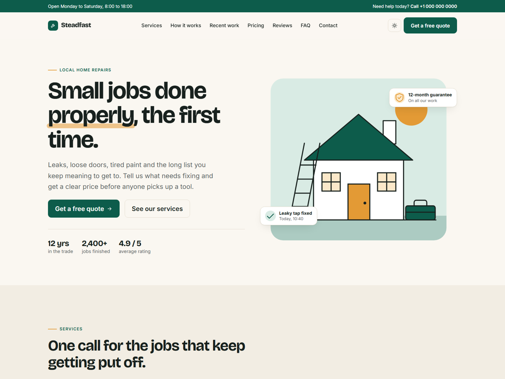

# Steadfast

A one-page Zola theme for small service businesses: tradespeople, repair shops, cleaners, gardeners and anyone else who sells their time locally. All the text lives in your content file, so you can launch a site without touching a template.



[Live demo](https://ello-lithuania.github.io/steadfast-zola/)

## Features

- Sections for hero, services, process, recent work, pricing, reviews, FAQ, contact and a call to action
- Every section is optional: leave it out of the content file and it disappears from the page
- Light and dark modes that follow the system setting, with a manual toggle
- Fully responsive, tested down to 375 px
- Built-in illustrations, which you can swap for your own photos
- Contact form with browser validation that posts to any form service or backend
- Regular pages and a simple blog using the same design
- Bootstrap 5.3 included locally: no jQuery, Sass or build step

## Installation

Add the theme to your site as a git submodule:

```sh
git submodule add https://github.com/ello-lithuania/steadfast-zola.git themes/steadfast
```

Then enable it in `config.toml`:

```toml
theme = "steadfast"
```

Copy `content/_index.md` from the theme to your own `content/` folder and edit the text.

## Configuration

These values are shared across the whole site. Add them under `[extra]` in `config.toml` to override the defaults in the theme:

```toml
[extra]
brand = "Your Business"
brand_icon = "wrench"
tagline = "One sentence about what you do."
topbar_text = "Open Monday to Saturday, 8:00 to 18:00"
phone = "+1 000 000 0000"
phone_href = "+10000000000"
email = "hello@example.com"
cta_label = "Get a free quote"
cta_url = "#contact"
og_image = "assets/og.jpg"
credit = true
nav = [
  { name = "Services", url = "#services" },
  { name = "Contact", url = "#contact" },
]
footer_columns = [
  { title = "Company", links = [{ name = "Services", url = "#services" }] },
]
```

Links starting with `#` point to sections on the home page and work from any page. Links starting with `/` are resolved against your `base_url`.

The icons available for `brand_icon` and the service cards are: `wrench`, `bolt`, `drop`, `brush`, `door`, `leaf`, `check`, `phone`, `mail`, `pin`, `clock`, `shield` and `star`.

## Home page content

The home page reads from the `[extra]` tables in `content/_index.md`: `hero`, `services`, `process`, `work`, `pricing`, `reviews`, `faq`, `contact` and `cta`. Delete a table to remove that section, and remember to remove its link from `nav` as well.

The reviews in the demo are placeholder text. Replace them with real reviews from your own customers.

To use photos instead of the illustrations, put the files in `static/assets/` and set `image` and `image_alt` on a hero or a work item:

```toml
{ image = "assets/kitchen.jpg", image_alt = "New kitchen tap", tag = "Plumbing", title = "Kitchen mixer replaced", text = "Done in under an hour." }
```

## Contact form

Without any setup, the form only validates in the browser and shows a demo message. Set `form_action` in the `contact` table to your form service or backend to start receiving messages:

```toml
form_action = "https://example.com/your-form-endpoint"
```

## Colours and fonts

The colours are CSS variables named `--sf-*` at the top of `static/assets/css/style.css`, one set for light mode and one for dark mode. To change them, copy that file to `static/assets/css/style.css` in your own site. Fonts (Bricolage Grotesque and Inter) load from Google Fonts in `templates/base.html`.

## Credits

Designed and built by [KokybiskaSvetaine.lt](https://kokybiskasvetaine.lt/). The footer credit can be turned off with `credit = false`.

Uses [Bootstrap](https://getbootstrap.com/) (MIT), [Bricolage Grotesque](https://fonts.google.com/specimen/Bricolage+Grotesque) and [Inter](https://fonts.google.com/specimen/Inter) (SIL Open Font License).

## License

MIT. See the [licence file](https://github.com/ello-lithuania/steadfast-zola/blob/main/LICENSE).
